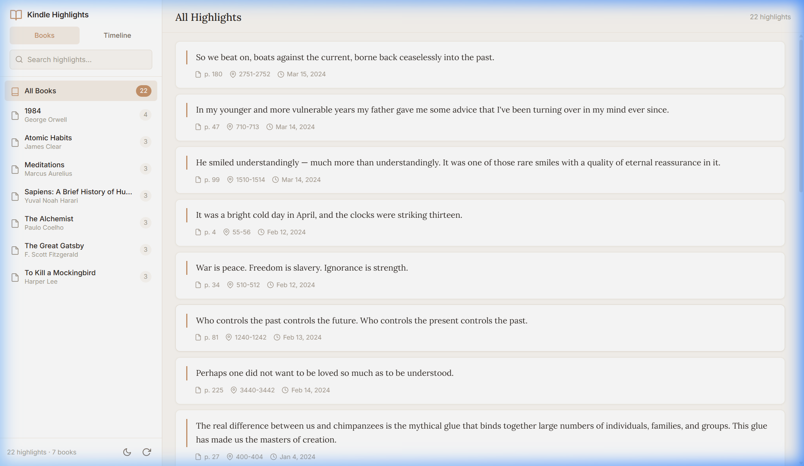

# Kindle Highlight Organizer

A clean, minimalist desktop web app to browse and search your Kindle highlights.

🔗 **[Live Demo](https://im-world.github.io/Kindle-Organizer/)**



## Features

- **Import** your `My Clippings.txt` file via drag-and-drop or file picker
- **Browse by Book** — sidebar groups highlights by book title
- **Timeline View** — see highlights ordered by date
- **Search** — instant full-text search across all highlights
- **Dark Mode** — toggle between light and dark themes
- **Fast** — no frameworks, no dependencies, just vanilla JS

## Getting Started

```bash
npm install
npm run dev
```

Then open the URL shown in your terminal.

## How to Export Clippings from Kindle

1. Connect your Kindle to your computer via USB
2. Navigate to the `documents` folder on your Kindle
3. Copy the `My Clippings.txt` file
4. Drop it into the app

## Tech Stack

- Vanilla JavaScript (no frameworks)
- Vite (build tool)
- CSS custom properties for theming

## License

MIT
